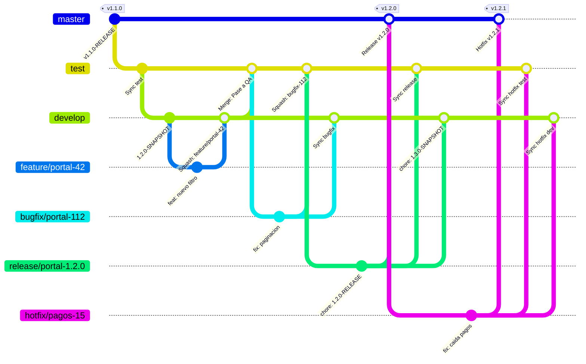

# Guía de Estándares Git y Flujo de Trabajo

Esta guía define las convenciones para la creación de ramas, escritura de commits y estrategias de integración en el proyecto, operando bajo un flujo de tres ambientes principales: **`develop` ➔ `test` ➔ `master`**.

> **💡 Sobre esta guía y mis proyectos anteriores:**  
> Este documento nace de mi propia experiencia trabajando en los proyectos que ves en este perfil y de la necesidad de poner orden conforme fueron creciendo. Por eso, notarás que varios de los repositorios más antiguos no siguen estas reglas al pie de la letra, ya que fueron creados antes de definir este estándar.  
>  
> A partir de ahora, estas convenciones son mi base de trabajo para todos los desarrollos nuevos y las estoy adoptando poco a poco en el mantenimiento de mis sistemas existentes, mirando hacia adelante sin reescribir su historial.


---

## 1. Resumen de Nomenclatura de Ramas

Todas las ramas temporales deben nombrarse en minúsculas, separando el prefijo con una barra diagonal (`/`) y el resto de los elementos con guiones, siguiendo la estructura general:

**`<prefijo>/<app>-nn`** *(o `<prefijo>/<app>-<version>` para liberaciones)*

Donde:
* **`<prefijo>`**: Tipo de cambio a realizar (`feature`, `bugfix`, `hotfix`, `release`, `refactor`, `chore`, `docs`).
* **`<app>`**: Nombre corto del sistema, módulo, servicio o aplicación afectada (ej. `portal`, `api`, `pagos`, `facturacion`).
* **`nn`**: Número de ticket, requerimiento o identificador de tarea.

### Flujo Visual de Ramas y Ambientes




Haz clic en cada prefijo en la tabla para ver su detalle, flujo y ejemplos de uso:

| Prefijo | Propósito General | ¿Cambia reglas de negocio? | Rama base | Rama(s) destino |
| :--- | :--- | :--- | :--- | :--- |
| **[`feature/<app>-nn`](#featureapp-nn)** | Nuevas funcionalidades o modificación de reglas de negocio en pantallas nuevas o existentes. | Sí | `develop` | `develop` |
| **[`bugfix/<app>-nn`](#bugfixapp-nn)** | Corrección de errores detectados en desarrollo o en el ambiente de pruebas (`test`). | No (restaura lo esperado) | `develop` o `test` | `develop` y `test` |
| **[`hotfix/<app>-nn`](#hotfixapp-nn)** | Corrección urgente de fallos críticos detectados directamente en producción (`master`). | No (restaura lo esperado) | `master` | `master`, `test` y `develop` |
| **[`release/<app>-<version>`](#releaseapp-version)** | Preparación de un corte de versión hacia producción (paso de `SNAPSHOT` a `RELEASE`). | No | `test` | `master` (y retorno a `test` / `develop`) |
| **[`refactor/<app>-nn`](#refactorapp-nn)** | Mejora de la estructura interna, lectura o rendimiento del código sin alterar su comportamiento. | **No** | `develop` | `develop` |
| **[`chore/<app>-nn`](#choreapp-nn)** | Tareas de mantenimiento, configuración de herramientas, dependencias o scripts de build. | No | `develop` | `develop` |
| **[`docs/<app>-nn`](#docsapp-nn)** | Creación o actualización exclusiva de documentación (README, diagramas, manuales). | No | `develop` | `develop` |

---

## 2. Detalle y Ejemplos por Tipo de Rama

### `feature/<app>-nn`
Se utiliza siempre que el desarrollo aporte valor funcional nuevo o altere la forma en que el sistema opera actualmente para el usuario final.

* **¿Cuándo aplicarlo?**
  * Creación de pantallas, módulos, reportes o endpoints nuevos.
  * Modificación de reglas de negocio existentes (ej. cambiar fórmulas de cálculo, validaciones o flujos de aprobación).
  * Incorporación de nuevos campos, filtros o controles en pantallas que ya existen.
* **Flujo:** Nace de `develop` y se integra de regreso a `develop` para posteriormente ser promovida a `test`.
* **Ejemplos de uso:**
  * `feature/portal-42` *(o `feature/portal-42-filtro-busqueda-fechas`)*: Se agrega un filtro nuevo a una pantalla existente y se ajusta el cálculo inicial de fechas de consulta.
  * `feature/reportes-58`: Se añade un botón para descargar información en formato `.xlsx`.
  * `feature/ventas-71`: Se actualiza la regla de negocio para calcular el porcentaje de comisión por ventas.

### `bugfix/<app>-nn`
Se aplica para corregir comportamientos anómalos o defectos encontrados durante el ciclo de desarrollo o durante las pruebas de certificación en **`test`**, **antes** de salir a producción.

* **¿Cuándo aplicarlo?**
  * El sistema no cumple con una regla de negocio previamente definida y aprobada.
  * Errores visuales, botones que no responden o validaciones rotas detectadas por QA en `test`.
  * Excepciones no controladas al ingresar ciertos datos en pruebas.
* **Flujo:** Si el error se detecta en `test`, nace desde `test` (o se corrige en `develop` y se sube a `test`). Debe quedar integrado en ambas ramas para evitar que el error reaparezca en futuros ciclos.
* **Ejemplos de uso:**
  * `bugfix/clientes-108`: El formulario rechazaba RFCs válidos con homoclave numérica en ambiente de pruebas.
  * `bugfix/portal-112`: Al avanzar a la página 2 de resultados, la tabla se quedaba en blanco.
  * `bugfix/contabilidad-119`: Los saldos negativos no mostraban el signo menos en la vista previa.

### `hotfix/<app>-nn`
Es una rama de emergencia. Se crea únicamente cuando se detecta un fallo crítico en el ambiente de **producción (`master`)** que afecta la operación real de los usuarios y no puede esperar al siguiente ciclo de liberación.

* **¿Cuándo aplicarlo?**
  * Caída total o parcial de un módulo crítico en producción.
  * Errores que bloquean procesos vitales (ej. facturación, pagos, inicio de sesión).
  * Brechas de seguridad que requieren cierre inmediato.
* **Flujo obligatorio en cascada:** Nace directamente desde `master`. Una vez resuelta, debe integrarse en orden hacia **`master` ➔ `test` ➔ `develop`** para asegurar que el parche no se pierda en las siguientes promociones de código.
* **Ejemplos de uso:**
  * `hotfix/pagos-15`: Error 500 al intentar procesar pagos con tarjeta en producción.
  * `hotfix/auth-19`: Usuarios activos no pueden autenticarse tras una actualización de certificados.
  * `hotfix/facturacion-23`: El sistema estaba generando folios repetidos bajo alta concurrencia.

### `release/<app>-<version>`
Se utiliza para preparar el empaquetado oficial de una nueva versión certificada en `test` antes de su despliegue final a producción (`master`). No usa número de ticket (`nn`), sino el número de versión semántica (`MAJOR.MINOR.PATCH`).

* **¿Cuándo aplicarlo?**
  * Actualización de la versión del artefacto en el `pom.xml` (ej. pasar de `1.2.0-SNAPSHOT` a `1.2.0-RELEASE`) una vez que `test` tiene el visto bueno de QA.
  * Ajustes finales de configuración de despliegue previos a liberar.
  * Preparación de la siguiente versión de desarrollo (ej. subir a `1.3.0-SNAPSHOT` en `test` y `develop` tras liberar).
* **Flujo:** Nace desde **`test`** cuando el paquete está listo para salir a producción. Se fusiona hacia **`master`** (generando su respectivo Tag) y se sincroniza de vuelta hacia **`test`** y **`develop`**.
* **Ejemplos de uso:**
  * `release/api-1.2.0`: Cambio de versión de `1.2.0-SNAPSHOT` a `1.2.0-RELEASE` en Maven para salida a producción.
  * `release/portal-2.0.0`: Preparación de liberación mayor del portal web desde `test` hacia `master`.

### `refactor/<app>-nn`
Se utiliza exclusivamente para mejorar la calidad interna del código sin alterar en lo más mínimo lo que el sistema hace hacia afuera. Si un usuario o un sistema externo prueba la aplicación antes y después del cambio, el resultado debe ser idéntico.

* **¿Cuándo aplicarlo?**
  * Optimización de consultas SQL lentas o algoritmos pesados para mejorar tiempos de respuesta.
  * Limpieza de deuda técnica: dividir funciones muy largas, renombrar variables confusas o eliminar código muerto.
  * Reorganización de carpetas, clases o patrones de diseño para facilitar el mantenimiento futuro.
* **Ejemplos de uso:**
  * `refactor/reportes-89`: Se reescribe un `JOIN` en base de datos para reducir el tiempo de carga de 8 segundos a 1 segundo, devolviendo exactamente los mismos registros.
  * `refactor/notificaciones-94`: Se separa la lógica de envío de correos que estaba mezclada dentro del controlador de usuarios.
  * `refactor/api-101`: Se borran métodos antiguos que ya no son invocados por ninguna pantalla.

### `chore/<app>-nn`
Abarca tareas rutinarias, técnicas o administrativas del proyecto que no modifican el código fuente de la aplicación ni afectan a los usuarios, pero son necesarias para mantener el entorno funcionando.

* **¿Cuándo aplicarlo?**
  * Actualización de versiones de librerías, frameworks o dependencias de terceros (`pom.xml`, `package.json`, `requirements.txt`).
  * Configuración de linters, formateadores de código, pipelines de CI/CD o archivos `.gitignore`.
  * Ajustes en variables de entorno o scripts de compilación.
* **Ejemplos de uso:**
  * `chore/api-30`: Actualización de dependencias de Spring Boot para resolver alertas de seguridad.
  * `chore/devops-35`: Creación del flujo automático en GitHub Actions para ejecutar pruebas al abrir un Pull Request.
  * `chore/portal-41`: Estandarización de reglas de formato de código para todo el equipo.

### `docs/<app>-nn`
Se reserva exclusivamente para cambios en la documentación del proyecto. No debe incluir modificaciones en archivos de código ejecutable.

* **¿Cuándo aplicarlo?**
  * Creación o actualización de archivos `README.md`, guías de instalación o manuales de arquitectura.
  * Documentación de endpoints (ej. archivos Swagger / OpenAPI).
  * Incorporación de diagramas de flujo o de base de datos en el repositorio.
* **Ejemplos de uso:**
  * `docs/core-12`: Se añaden los pasos para configurar Docker en entornos locales nuevos.
  * `docs/api-18`: Se detallan los parámetros de entrada y salida de los webhooks disponibles.

---

## 3. Convenciones para Mensajes de Commit

Seguimos el estándar **Conventional Commits** para mantener un historial limpio y legible.

### Estructura
```text
<tipo>(<app o alcance opcional>): <descripción breve en imperativo>

[cuerpo opcional explicando el "qué" y el "por qué"]
```

### Reglas básicas
* Usa el modo imperativo en presente (ej. *"agrega"*, *"corrige"*, *"actualiza"*, no *"agregado"* ni *"corrigiendo"*).
* No termines el título con punto final.
* Mantén la primera línea por debajo de los 72 caracteres.

### Tipos permitidos y ejemplos
* **`feat:`** Nueva funcionalidad o cambio de regla de negocio.
  * *Ejemplo:* `feat(portal): agrega filtro por estatus y ajusta calculo de fechas`
* **`fix:`** Corrección de un error (aplica para `bugfix` y `hotfix`).
  * *Ejemplo:* `fix(auth): corrige validacion de token expirado`
* **`refactor:`** Cambios de código que no corrigen errores ni añaden funciones.
  * *Ejemplo:* `refactor(usuarios): extrae logica de permisos a un servicio independiente`
* **`chore:`** Cambios en configuración, dependencias, versiones de release o tareas internas.
  * *Ejemplo:* `chore(release): actualiza version del artifact a 1.2.0-RELEASE`
* **`docs:`** Cambios únicamente en la documentación.
  * *Ejemplo:* `docs(api): documenta parametros del endpoint de reportes`
* **`style:`** Cambios de formato (espacios, tabulaciones, punto y coma) que no afectan la lógica.
  * *Ejemplo:* `style(ventas): aplica formato estandar de linter`
* **`test:`** Añadir o corregir pruebas unitarias o de integración.
  * *Ejemplo:* `test(portal): agrega pruebas para el nuevo filtro de periodo`
---

## 4. Estrategias de Fusión y Promoción entre Ramas

Para mantener un historial de Git ordenado, evitar conflictos duplicados entre ambientes y garantizar la trazabilidad en GitHub, aplicamos las siguientes reglas:

### 1. Actualizar tu rama de trabajo (`Rebase`)

Antes de abrir un Pull Request, sincroniza tu rama con los últimos cambios de tu rama base (`develop` o `test`) usando **Rebase**. Esto evita commits de fusión innecesarios dentro de tu historial de trabajo.
```
bash git checkout feature/portal-42 git fetch origin git rebase origin/develop 
```
*(Nota: Nunca hagas rebase sobre develop, test o master).*

### 2. Integrar ramas de trabajo diario a develop (Squash and Merge)

Al aprobar un PR de trabajo diario (feature, bugfix, refactor, chore, docs) hacia develop, utiliza Squash and Merge en GitHub.
• ¿Qué hace? Agrupa todos tus commits intermedios (ej. *"wip"*, *"ajuste menor"*, *"fix typo"*) en un **único commit limpio** en `develop`.
• Ventaja: Mantiene el historial de `develop` lineal, donde cada commit corresponde exactamente a una tarea o ticket terminado.

### 3. Promover cambios entre ramas permanentes (Merge Commit estándar)

Para promover código entre ambientes (`develop` ➔ `test` y `release` ➔ `master`) o bajar parches (`master` ➔ `test` ➔ `develop`), utiliza **siempre un `Merge Commit` estándar (Create a merge commit)** en GitHub.

* **Regla crítica: Nunca uses `Squash and Merge` entre `develop`, `test` y `master`.** Si aplastas los commits entre ramas permanentes, Git pierde la referencia de los ancestros compartidos y generará conflictos falsos en cada pase futuro.
* **Trazabilidad:** Al cerrar un `release/<app>-<version>` en `master` mediante `Merge Commit`, crea inmediatamente la etiqueta de versión (`git tag v1.2.0`) sobre ese commit de fusión.

